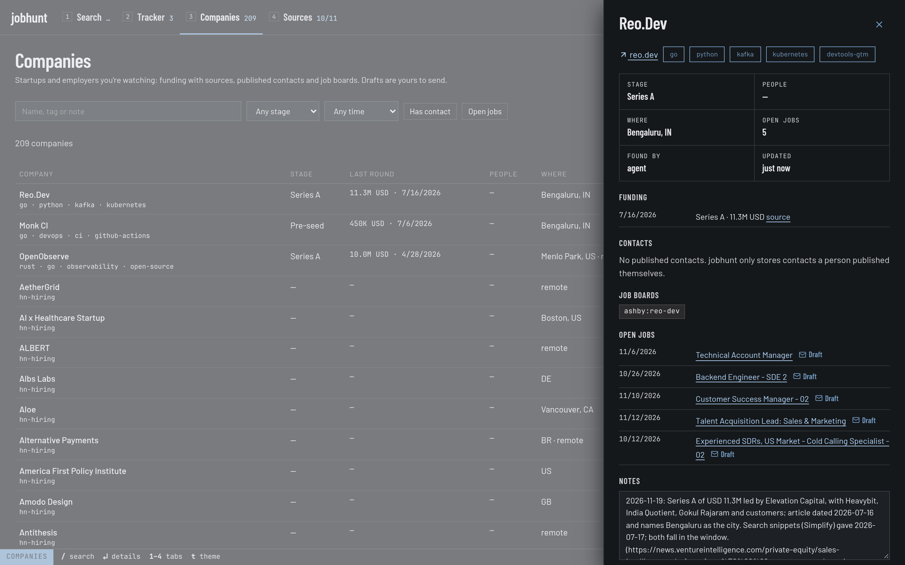
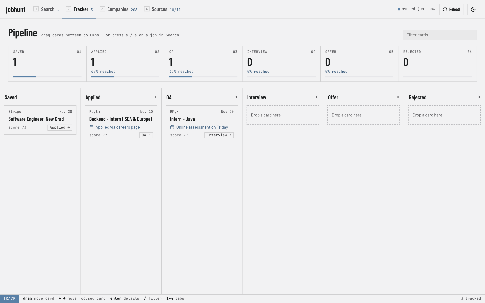

# jobhunt

**Search every legal job source at once from your terminal, and track your applications in one place.**

jobhunt is a single Go binary for students and early-career engineers looking for **internships, new-grad and entry-level roles**. It's tuned for India by default, and the US, Japan, Europe and remote jobs work too.

Use it from the terminal, a TUI, or a local web UI. It also keeps a list of startups worth contacting directly, and gives AI agents tools to research them with a source for every fact.


## Features

- **One search, every source.** Queries about 90 company job boards, remote boards, HN "Who is Hiring" and optional APIs concurrently.
- **Less noise.** Classifies each job's type, level, work mode, CS area and visa support, then filters out what you didn't ask for.
- **No duplicates.** Merges the same posting found on different sources.
- **Ranked results.** Scores every job 0–100 for how well it fits your search.
- **New-job tracking.** Marks jobs you haven't seen before with ★; `--new-only` shows just those.
- **Application tracker.** saved → applied → OA → interview → offer / rejected, with notes and history.
- **Watch mode and daily digest.** Re-runs a search on a schedule and notifies you of new matches, or sends one digest a day of new jobs and companies.
- **Profile.** Say once what you want (roles, stack in priority order, projects, places, which companies) and every search, the digest and the agents use it.
- **Companies to watch.** A list of startups with their funding rounds, headcount, job boards and published contacts, every fact stored with its source URL. It's filled from SEC and Indian company filings, HN hiring posts, an agent, or by hand.
- **Web UI.** `jobhunt serve --open`: search with live progress, a tracker board, the companies list with outreach drafts, and source health.
- **Agent tools.** `jobhunt mcp` lets Claude Code and other MCP clients search jobs and research companies; the `company-scout` agent ships with the repo.
- **Headless mode.** `jobhunt feed` streams versioned NDJSON events for queues, databases and agents, with at-least-once cursors and a signed webhook.
- **Local API.** The web UI runs on a token-protected JSON API on localhost that you can use too.
- **Legal by design.** Uses only public APIs, ATS job-board APIs and RSS feeds, and respects their terms and rate limits. Sites that forbid automation (LinkedIn, Indeed, Naukri, Internshala, Glassdoor, Crunchbase, Wellfound) get pre-filled browser links instead. jobhunt never guesses email addresses and never sends anything for you.

## Install

Needs Go 1.27+ on Linux, macOS or Windows.

```sh
git clone https://github.com/itxkarthik/jobhunt && cd jobhunt
make install          # → ~/.local/bin/jobhunt  (PREFIX=/other/dir make install)
jobhunt config init   # optional: writes ~/.config/jobhunt/config.yaml
```

If you get `command not found: jobhunt`, add `~/.local/bin` to your PATH: `export PATH="$HOME/.local/bin:$PATH"`.

## Quick start

None of the default sources needs an API key.

```sh
jobhunt search --country IN --type internship --area backend   # search
jobhunt preset save india-backend -c IN -t internship -a backend
jobhunt tui -p india-backend                                    # browse interactively
jobhunt tracker set 53be applied --note "via careers page"      # track (any unique KEY prefix)
jobhunt watch -p india-backend --every 6h --min-score 60        # get notified
jobhunt serve --open                                            # web UI in your browser
```


- **★**: you haven't seen this job in an earlier search.
- **SCORE**: 0–100 fit for this search ([how it's scored](#scoring)).
- **KEY**: stable job ID for `tracker`, `hide` and `unhide`.
- **Sources** (below the table): what each source did: `ok`, `cached`, `skipped` or `error`. A failing source falls back to its last cached results.
- **Also search**: links to sites jobhunt can't query, pre-filled with your filters.

## Usage

```sh
# Search
jobhunt search -c IN,remote-global -t new-grad -k Go,Kubernetes -x senior
jobhunt search -c JP -t internship --visa
jobhunt search -p india-backend -k Go   # flags override the preset
#   --new-only  --refresh  --include-unknown  --strict-country  --show-hidden  -n -1 (all rows)

# Presets
jobhunt preset save <name> [filters] | list | show <name> | delete <name>

# Tracker
jobhunt tracker set <key> saved|applied|oa|interview|offer|rejected [--note "…"]
jobhunt tracker [--status applied,interview] | show <key> | rm <key>
jobhunt hide <key> | unhide <key>

# Export (csv, json or md, from the file extension)
jobhunt export -p india-backend -o jobs.csv
jobhunt export --tracked -o applications.md

# Watch (notify-send on Linux, osascript on macOS; minimum interval 15m)
jobhunt watch -p india-backend --every 6h
jobhunt watch -p india-backend --once   # for cron or a systemd timer

# Profile and digest (see "Profile and digest" below)
jobhunt profile show
jobhunt search --profile
jobhunt digest [--notify] [--webhook] [--dry-run]

# Companies (see "Companies" below)
jobhunt companies [--profile] [-c IN --city Bengaluru] [--stage seed,series-a] [--hiring any]
jobhunt companies show <name> | set <name> [fields] | rm <name>
jobhunt companies sync [--every 6h] | import edgar|mca|hn | links

# Web UI, API and agents
jobhunt serve [--open]
jobhunt mcp [--read-only]

# Sources and config
jobhunt sources [--check-boards]
jobhunt config init | path
```

Every command has `--help` with examples.

### Filters

Available on `search`, `tui`, `export`, `watch` and `preset save`.

| Flag | Values |
|---|---|
| `-c, --country` | `IN US JP UK DE CA SG NL AU AE remote-global` (default `IN`) |
| `-t, --type` | `internship new-grad full-time part-time contract` |
| `-a, --area` | `backend frontend full-stack mobile ml-ai data-engineering data-science devops systems hpc-gpu security embedded qa research blockchain gamedev` |
| `-m, --mode` | `remote hybrid onsite` |
| `-e, --experience` | `intern entry mid senior` |
| `-k, --keywords` / `-x, --exclude` | include jobs mentioning any / drop jobs mentioning any |
| `--posted-within` | `24h 3d 7d 30d` |
| `--visa` | only jobs that mention visa sponsorship |
| `--min-salary N --currency INR` | minimum advertised annual salary |
| `-p, --preset` | start from a saved preset |
| `--profile` | fill what flags and the preset leave empty from your [profile](#profile-and-digest) |
| `--company-stage` / `--company-headcount` | only jobs at [listed companies](#companies) at these stages or sizes |

Countries, types, areas and modes left out take the defaults from your config; `any` (as in `-c any`) lifts the restriction instead.

`--country IN` also includes remote jobs open worldwide or to a region containing India; `--strict-country` drops them. Jobs whose type, area or country is unclear are dropped unless you pass `--include-unknown`.

### TUI keys

| Key | Action |
|---|---|
| `tab` / `shift+tab` | switch pane: filters → results → detail |
| `↑↓` / `jk` | move or scroll |
| `space` / `enter` | toggle a filter (re-searches) |
| `/` | edit keywords |
| `s` | cycle sort: score → date → company |
| `o` | open in browser |
| `S` / `a` | save to tracker / mark applied |
| `h` | hide job |
| `r` | refetch, bypassing the cache |
| `?` / `q` | help / quit |

## Web UI

```sh
jobhunt serve --open    # http://127.0.0.1:7777
```

The browser UI runs from the same binary, with no build step and nothing loaded from the internet. It has four tabs:

- **Search:** the filters and results from the CLI, with live progress per source and a details panel for each job.
- **Tracker:** your applications as a board from saved to offer, with notes and history.
- **Companies:** the [companies list](#companies) with filters, details, notes and an outreach email draft.
- **Sources:** what each source returned, its errors and its cache.






On first load the page asks for the token `jobhunt serve` prints. Set `serve.token` in the config or `JOBHUNT_SERVE_TOKEN` (16+ characters) to keep the same token across restarts. Light and dark themes follow your system; press `t` to switch.

## Profile and digest

The `profile:` section of the config says what you're looking for:

```yaml
profile:
  types: [internship, new-grad]
  experience: [intern, entry]
  areas: [backend, systems, devops]
  stack: [go, rust, python]              # earlier ones score higher
  projects: [raft, kubernetes, rag]      # a job mentioning one gets a ranking bonus
  countries: [IN]
  posted_within: 14d
  min_score: 50                          # the digest leaves out lower scores
  skip_requires_experience: true         # drop postings that ask for prior work or internships
  skip_onsite_abroad: true               # drop onsite and hybrid roles outside your countries
  companies:                             # which companies are worth your time
    stages: [seed, series-a]
    headcounts: [1-10, 11-50, 51-200]
    countries: [IN]
    cities: [Bengaluru]
    remote_ok: true                      # or hiring remotely
    funded_within: 270d                  # raised 3 to 9 months ago
    funded_before: 90d
```

- `jobhunt search --profile` (also `tui`, `feed` and `export`) fills what your flags and preset leave empty from the profile, applies its skips and ranks your stack. Flags win over a preset, and a preset wins over the profile.
- `jobhunt companies --profile` lists companies that match its `companies` section.
- `jobhunt digest` uses the profile by default. It prints the jobs and companies that are new since the last digest, and nothing when nothing is new. Add `--notify` for a desktop notification and `--webhook` to POST it as JSON (with Markdown included, for Telegram, Slack or Discord bridges). The first digest shows the best of what matches now; later ones only what's new.
- `jobhunt profile show` prints the profile and checks it.

To get a digest every weekday morning, install [`docs/examples/jobhunt-digest.service`](docs/examples/jobhunt-digest.service) and [`.timer`](docs/examples/jobhunt-digest.timer) in `~/.config/systemd/user/` and run `systemctl --user enable --now jobhunt-digest.timer`.

## Companies

Small startups often hire without posting on big job boards. The companies list keeps track of the ones worth contacting: their funding rounds, headcount, job boards and contacts. Every round and contact is stored with the URL it was published at.

```sh
jobhunt companies --profile                                     # the ones that fit your profile
jobhunt companies -c IN --city Bengaluru --stage seed,series-a --funded-within 270d
jobhunt companies show acme                                     # details and open jobs
jobhunt companies set "Acme AI" --stage seed --headcount 12 --board ashby:acme --website https://acme.ai
jobhunt companies set "Acme AI" --round seed,2500000,USD,2026-09-02,https://acme.ai/blog/seed
```

A company's job boards (`--board greenhouse:slug`, and `lever`, `ashby`, `workable`, `recruitee`) are checked once when added and then searched like the built-in ones, so its jobs show up in every search. Stage, headcount and funding stay `unknown` until someone records them with a source, and filters on them leave unknowns out.

**Filling the list.** `jobhunt companies sync` runs every importer that's configured. Each one fetches only what's new since its last run:

| Importer | What it adds | Setup |
|---|---|---|
| `hn` | companies hiring in the latest HN "Who is hiring?" thread, with the job boards linked in their posts | none |
| `boards` | rechecks added job boards and reports ones that have gone | none |
| `edgar` | US funding rounds from SEC Form D filings | `importers.edgar.user_agent: "Your Name you@example.com"` (SEC asks every client to name a contact; sent only to sec.gov) |
| `mca` | Indian companies registered recently, by state and industry, from the MCA company master data | a free [data.gov.in](https://www.data.gov.in) API key in `importers.mca.api_key` or `JOBHUNT_DATAGOV_API_KEY` |

Run it every 6 hours with [`docs/examples/jobhunt-sync.service`](docs/examples/jobhunt-sync.service) and [`.timer`](docs/examples/jobhunt-sync.timer), or `jobhunt companies sync --every 6h`. For sites that forbid automated access, such as Crunchbase, Tracxn, Wellfound and YC's directory, `jobhunt companies links` prints links to browse yourself.

**Contact rules.** jobhunt stores a contact only when the person published it themselves (on a careers or team page, a hiring post, or their own site) and always with that page's URL. It never guesses an address from a name pattern and never uses an email finder. The web UI and the digest draft an outreach email from what's recorded and your profile, for you to edit and send yourself; jobhunt never sends email or applies anywhere.

## Agents (MCP)

`jobhunt mcp` serves jobhunt to AI agents over the Model Context Protocol, on stdin and stdout with no network port. Register it with Claude Code:

```sh
claude mcp add jobhunt -- jobhunt mcp
claude mcp add jobhunt-read-only -- jobhunt mcp --read-only   # read tools only
```

or copy [`docs/examples/mcp.json`](docs/examples/mcp.json) into your MCP client's config.

- **Read tools:** `search_jobs`, `get_job`, `list_companies`, `get_company`, `get_profile`, `list_sources`.
- **Write tools:** `upsert_company`, `add_contact`, `add_board`, `track_job`, `add_note`. `--read-only` leaves them out.

Everything an agent sends is validated and sanitized like your own input. Rounds and contacts are refused without a source URL, and no tool returns keys or tokens.

The repo includes two Claude Code agents in [`.claude/agents/`](.claude/agents/). `company-scout` researches companies that fit your profile and records each fact with its source; `company-scout-readonly` does the same research and only reports it. In Claude Code, ask for example:

> run company-scout: find seed or Series A startups in Bengaluru that use Go, raised in the last 9 months, and record them

Both follow the contact rules above and don't fetch sites whose terms forbid it. The prompts are plain Markdown, so other MCP clients can use them too.

## Headless mode

`jobhunt feed` runs a search and writes one JSON event per line to stdout, with logs on stderr, so you can build pipelines and agent systems on top of it. Each run emits a `source` event per source, then a `job` event per selected job (best score first), then a `company` event per new or changed company with `--companies`, then a `run` summary. The format is versioned and documented in [`docs/feed.schema.json`](docs/feed.schema.json).

```sh
jobhunt feed -p india-backend --new-only | jq -c 'select(.type=="job") | .job | {key, score, title, url}'
jobhunt feed -p india-backend --cursor agent --min-score 60 | ./agent.py     # each job delivered once
jobhunt feed -p india-backend --cursor db --every 6h | ./load-into-db.sh     # long-running
```

- **`--cursor NAME`** gives each consumer at-least-once delivery. A run emits the matching jobs that consumer hasn't received yet. Until stdout and the webhook accept a batch, its jobs stay pending and are resent, even if a posting has left its source. Dedupe on `job.key`.
- **`--since 24h`** (or a date or RFC 3339 time) replays jobs first seen since then, without state.
- **`--companies`** adds the companies list. Company events are snapshots of the current record: upsert on `record.key`. With a cursor, a consumer gets each company's latest version it hasn't received.
- **Webhook:** set `JOBHUNT_WEBHOOK_URL` (or `--webhook`) to also POST each batch as `application/x-ndjson`. Failures are retried with backoff.
- **Signing:** set `JOBHUNT_WEBHOOK_SECRET` (16+ characters) to sign requests. Receivers should compute `"sha256=" + hex(HMAC_SHA256(secret, "<X-Jobhunt-Timestamp>.<body>"))`, compare it to `X-Jobhunt-Signature` in constant time, and reject stale timestamps.

## Local API

`jobhunt serve` runs a JSON API on `127.0.0.1:7777`. It covers search (with a live Server-Sent Events stream), the tracker, hiding, presets, the companies list with outreach drafts, and source health. The web UI is built on this API, and you can build on it too.

```sh
jobhunt serve      # prints the URL and a bearer token
curl -H "Authorization: Bearer $TOKEN" -H 'Content-Type: application/json' \
  -d '{"types":["internship"],"areas":["backend"],"limit":5}' http://127.0.0.1:7777/api/search
```

The server listens on loopback only and requires the token on every `/api` request. It also rejects foreign `Host` headers and cross-origin writes. Every endpoint is documented in [`docs/api.md`](docs/api.md).

## Sources

| Source | Key | Notes |
|---|---|---|
| Greenhouse, Lever, Ashby, Workable, Recruitee | – | 93 built-in company boards: big tech, Indian startups and remote-first startups ([`companies.yaml`](internal/sources/ats/companies.yaml)), plus boards you add with `jobhunt companies set --board` |
| HN "Who is Hiring" | – | latest monthly thread, via the Algolia API |
| Himalayas, RemoteOK, Remotive, We Work Remotely, Arbeitnow | – | remote and EU jobs, always linked back to the source |
| JSearch | `JOBHUNT_JSEARCH_API_KEY` | **opt-in**, freemium. LinkedIn and Indeed listings via Google Jobs. Accepts [OpenWeb Ninja](https://www.openwebninja.com) or RapidAPI keys |
| X recent search | `JOBHUNT_X_BEARER_TOKEN` | **opt-in**, pay-per-use |
| Adzuna | `JOBHUNT_ADZUNA_APP_ID` / `_APP_KEY` | **opt-in** |
| LinkedIn, Indeed, Naukri, Internshala, Glassdoor, Wellfound, YC, Cutshort, Instahyre, TokyoDev, Japan Dev | – | **browser links only**, never fetched |

To enable an opt-in source, set `sources.<name>.enabled: true` in the config and provide its key in the config or the env var. The company importers (SEC EDGAR, MCA, HN leads) are listed under [Companies](#companies).

## Configuration

`~/.config/jobhunt/config.yaml` is optional (override the path with `JOBHUNT_CONFIG`).

```yaml
cache_ttl: 1h
timeout: 20s
defaults:
  countries: [IN]
  types: [internship, new-grad]
  limit: 50
ranking: { match: 35, recency: 25, level: 25, fit: 10, info: 5 }
# companies_file: ~/.config/jobhunt/companies.yaml   # your own target companies
# keywords_file:  ~/.config/jobhunt/keywords.yaml    # your own classifier rules
sources:
  jsearch: { enabled: false, api_key: "", ttl: 24h }
feed:
  # webhook_url: https://example.com/hooks/jobhunt   # or JOBHUNT_WEBHOOK_URL
  # webhook_secret: ""                               # or JOBHUNT_WEBHOOK_SECRET, 16+ characters
serve:
  # token: ""                                        # or JOBHUNT_SERVE_TOKEN, 16+ characters
importers:
  edgar: { }   # user_agent: "Your Name you@example.com"   (or JOBHUNT_EDGAR_USER_AGENT)
  mca:   { states: [KA], nic: ["62", "63"] }   # api_key, or JOBHUNT_DATAGOV_API_KEY
# profile: …   see "Profile and digest"
```

`jobhunt config init` writes the full commented example. Keep keys in env vars or this file (mode 0600), never on the command line.

To target your own companies, copy [`companies.yaml`](internal/sources/ats/companies.yaml), add boards by their careers-page slug, point `companies_file` at it, and run `jobhunt sources --check-boards`.

## How it works

```
 flags / preset ──► Filters
                      │
       ┌──────────────┴───────────────┐   sources run concurrently
       ▼              ▼               ▼   (cache · rate limit · timeout · retries)
   Greenhouse     Himalayas   …   HN Who's Hiring
       └──────────────┬───────────────┘
                      ▼
   sanitize → classify → filter → dedup → rank → hidden / ★ new
                      ▼
     table │ TUI │ web UI │ export │ feed │ digest │ MCP
```

Results are cached in SQLite per source, so repeat searches take under a second. A slow or broken source never breaks the search.

### Scoring

| Component | Max | Full points when… |
|---|---|---|
| Match | 35 | your keywords appear in the title and the job is in your areas |
| Recency | 25 | posted just now; halves every 7 days |
| Level | 25 | internship, new-grad or entry-level |
| Fit | 10 | your exact country and mode (worldwide remote scores 70%) |
| Info | 5 | salary and/or visa sponsorship stated |

Weights are configurable under `ranking:`. Each job in `jobhunt feed` and the local API carries `score_parts`, the points it got for each component.

## Privacy and security

- All data stays local in `~/.local/share/jobhunt/jobhunt.db`, in a folder only you can read. The only network traffic is requests to the sources above.
- Fetched text is untrusted: terminal escapes, control and bidi characters are stripped, and only `http(s)` URLs are kept.
- CSV exports neutralise spreadsheet formulas; Markdown links are escaped.
- API keys live in your config (mode 0600) or env vars and are redacted from errors.
- Links and notifications run fixed programs, never a shell.
- The web UI and API listen on loopback only, need the token on every request, reject foreign `Host` headers and cross-origin writes, and escape all fetched text.
- Contacts are stored only as their owners published them, with the source URL. jobhunt never sends email or messages.

## Troubleshooting

| Symptom | Fix |
|---|---|
| First search takes 20–60s | Normal: all company boards are fetched once, then cached |
| Few or no results | Try `--include-unknown`, widen `-a`, add `-c remote-global`, or use the **Also search** links |
| A source shows `error` | `jobhunt sources` shows recent errors; `--check-boards` finds stale company slugs |
| No desktop notification | Install `libnotify` (`notify-send`) on Linux |
| `companies --profile` shows nothing | The profile's stage, size and funding filters leave out companies where those are unknown. Record them with `companies set`, or ask the `company-scout` agent |
| The web UI asks for a token every time | Set `serve.token` or `JOBHUNT_SERVE_TOKEN` |

<details>
<summary>Run watch in the background with systemd</summary>

For the companies sync and the daily digest, use the ready-made units in [`docs/examples/`](docs/examples/).

`~/.config/systemd/user/jobhunt-watch.service`:

```ini
[Unit]
Description=jobhunt watch

[Service]
ExecStart=%h/.local/bin/jobhunt watch --preset india-backend --every 6h --min-score 60
Restart=on-failure

[Install]
WantedBy=default.target
```

```sh
systemctl --user enable --now jobhunt-watch
```

</details>

## Contributing

Contributions are welcome: new legal sources, company boards and classifier rules. See [CONTRIBUTING.md](CONTRIBUTING.md). AI coding agents should read [AGENTS.md](AGENTS.md).

## License

[MIT](LICENSE) © 2026 itxkarthik
