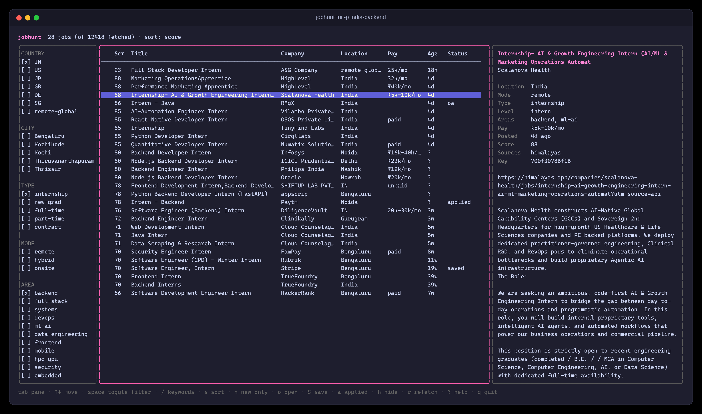
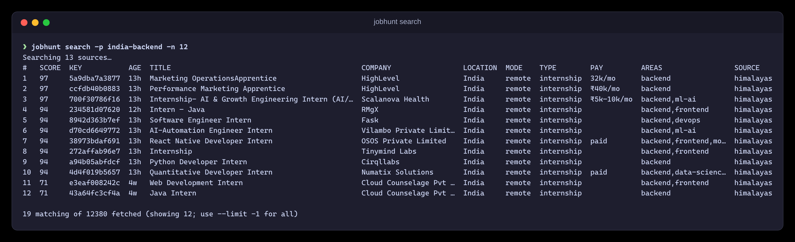

# jobhunt

**Search every legal job source at once from your terminal, and track your applications in one place.**

jobhunt is a single Go binary for students and early-career engineers looking for **internships, new-grad and entry-level roles**. It's tuned for India by default, and the US, Japan, Europe and remote jobs work too.



## Features

- **One search, every source.** Queries about 90 company job boards, remote boards, HN "Who is Hiring" and optional APIs concurrently.
- **Less noise.** Classifies each job's type, level, work mode, CS area and visa support, then filters out what you didn't ask for.
- **No duplicates.** Merges the same posting found on different sources.
- **Ranked results.** Scores every job 0–100 for how well it fits your search.
- **New-job tracking.** Marks jobs you haven't seen before with ★; `--new-only` shows just those.
- **Application tracker.** saved → applied → OA → interview → offer / rejected, with notes and history.
- **Watch mode.** Re-runs a search on a schedule and sends a desktop notification when new matches appear.
- **Headless mode.** `jobhunt feed` streams versioned NDJSON events for queues, databases and agents, with at-least-once cursors and a signed webhook.
- **Legal by design.** Uses only public APIs, ATS job-board APIs and RSS feeds, and respects their terms and rate limits. Sites that forbid automation (LinkedIn, Indeed, Naukri, Internshala, Glassdoor) get pre-filled browser links instead.

## Install

Needs Go 1.27+ on Linux, macOS or Windows.

```sh
git clone https://github.com/itxkarthik/jobhunt && cd jobhunt
make install          # → ~/.local/bin/jobhunt  (PREFIX=/other/dir make install)
jobhunt config init   # optional: writes ~/.config/jobhunt/config.yaml
```

If you get `command not found: jobhunt`, add `~/.local/bin` to your PATH: `export PATH="$HOME/.local/bin:$PATH"`.

## Quick start

None of the default sources needs an API key.

```sh
jobhunt search --country IN --type internship --area backend   # search
jobhunt preset save india-backend -c IN -t internship -a backend
jobhunt tui -p india-backend                                    # browse interactively
jobhunt tracker set 53be applied --note "via careers page"      # track (any unique KEY prefix)
jobhunt watch -p india-backend --every 6h --min-score 60        # get notified
```



- **★**: you haven't seen this job in an earlier search.
- **SCORE**: 0–100 fit for this search ([how it's scored](#scoring)).
- **KEY**: stable job ID for `tracker`, `hide` and `unhide`.
- **Sources** (below the table): what each source did: `ok`, `cached`, `skipped` or `error`. A failing source falls back to its last cached results.
- **Also search**: links to sites jobhunt can't query, pre-filled with your filters.

## Usage

```sh
# Search
jobhunt search -c IN,remote-global -t new-grad -k Go,Kubernetes -x senior
jobhunt search -c JP -t internship --visa
jobhunt search -p india-backend -k Go   # flags override the preset
#   --new-only  --refresh  --include-unknown  --strict-country  --show-hidden  -n -1 (all rows)

# Presets
jobhunt preset save <name> [filters] | list | show <name> | delete <name>

# Tracker
jobhunt tracker set <key> saved|applied|oa|interview|offer|rejected [--note "…"]
jobhunt tracker [--status applied,interview] | show <key> | rm <key>
jobhunt hide <key> | unhide <key>

# Export (csv, json or md, from the file extension)
jobhunt export -p india-backend -o jobs.csv
jobhunt export --tracked -o applications.md

# Watch (notify-send on Linux, osascript on macOS; minimum interval 15m)
jobhunt watch -p india-backend --every 6h
jobhunt watch -p india-backend --once   # for cron or a systemd timer

# Sources and config
jobhunt sources [--check-boards]
jobhunt config init | path
```

Every command has `--help` with examples.

### Filters

Available on `search`, `tui`, `export`, `watch` and `preset save`.

| Flag | Values |
|---|---|
| `-c, --country` | `IN US JP UK DE CA SG NL AU AE remote-global` (default `IN`) |
| `-t, --type` | `internship new-grad full-time part-time contract` |
| `-a, --area` | `backend frontend full-stack mobile ml-ai data-engineering data-science devops systems hpc-gpu security embedded qa research blockchain gamedev` |
| `-m, --mode` | `remote hybrid onsite` |
| `-e, --experience` | `intern entry mid senior` |
| `-k, --keywords` / `-x, --exclude` | include jobs mentioning any / drop jobs mentioning any |
| `--posted-within` | `24h 3d 7d 30d` |
| `--visa` | only jobs that mention visa sponsorship |
| `--min-salary N --currency INR` | minimum advertised annual salary |
| `-p, --preset` | start from a saved preset |

`--country IN` also includes remote jobs open worldwide or to a region containing India; `--strict-country` drops them. Jobs whose type, area or country is unclear are dropped unless you pass `--include-unknown`.

### TUI keys

| Key | Action |
|---|---|
| `tab` / `shift+tab` | switch pane: filters → results → detail |
| `↑↓` / `jk` | move or scroll |
| `space` / `enter` | toggle a filter (re-searches) |
| `/` | edit keywords |
| `s` | cycle sort: score → date → company |
| `o` | open in browser |
| `S` / `a` | save to tracker / mark applied |
| `h` | hide job |
| `r` | refetch, bypassing the cache |
| `?` / `q` | help / quit |

## Headless mode

`jobhunt feed` runs a search and writes one JSON event per line to stdout, with logs on stderr, so you can build pipelines and agent systems on top of it. Each run emits a `source` event per source, then a `job` event per selected job (best score first), then a `run` summary. The format is versioned and documented in [`docs/feed.schema.json`](docs/feed.schema.json).

```sh
jobhunt feed -p india-backend --new-only | jq -c 'select(.type=="job") | .job | {key, score, title, url}'
jobhunt feed -p india-backend --cursor agent --min-score 60 | ./agent.py     # each job delivered once
jobhunt feed -p india-backend --cursor db --every 6h | ./load-into-db.sh     # long-running
```

- **`--cursor NAME`** gives each consumer at-least-once delivery. A run emits the jobs first seen since that consumer's last successful run, and the cursor only advances after the batch is delivered. Dedupe on `job.key`.
- **`--since 24h`** (or a date or RFC 3339 time) replays jobs first seen since then, without state.
- **Webhook:** set `JOBHUNT_WEBHOOK_URL` (or `--webhook`) to also POST each batch as `application/x-ndjson`. Failures are retried with backoff.
- **Signing:** set `JOBHUNT_WEBHOOK_SECRET` (16+ characters) to sign requests. Receivers should compute `"sha256=" + hex(HMAC_SHA256(secret, "<X-Jobhunt-Timestamp>.<body>"))`, compare it to `X-Jobhunt-Signature` in constant time, and reject stale timestamps.

## Sources

| Source | Key | Notes |
|---|---|---|
| Greenhouse, Lever, Ashby, Workable, Recruitee | – | ~90 company boards: big tech, Indian startups and remote-first startups ([`companies.yaml`](internal/sources/ats/companies.yaml)) |
| HN "Who is Hiring" | – | latest monthly thread, via the Algolia API |
| Himalayas, RemoteOK, Remotive, We Work Remotely, Arbeitnow | – | remote and EU jobs, always linked back to the source |
| JSearch | `JOBHUNT_JSEARCH_API_KEY` | **opt-in**, freemium. LinkedIn and Indeed listings via Google Jobs. Accepts [OpenWeb Ninja](https://www.openwebninja.com) or RapidAPI keys |
| X recent search | `JOBHUNT_X_BEARER_TOKEN` | **opt-in**, pay-per-use |
| Adzuna | `JOBHUNT_ADZUNA_APP_ID` / `_APP_KEY` | **opt-in** |
| LinkedIn, Indeed, Naukri, Internshala, Glassdoor, Wellfound, YC, Cutshort, Instahyre, TokyoDev, Japan Dev | – | **browser links only**, never fetched |

To enable an opt-in source, set `sources.<name>.enabled: true` in the config and provide its key in the config or the env var.

## Configuration

`~/.config/jobhunt/config.yaml` is optional (override the path with `JOBHUNT_CONFIG`).

```yaml
cache_ttl: 1h
timeout: 20s
defaults:
  countries: [IN]
  types: [internship, new-grad]
  limit: 50
ranking: { match: 35, recency: 25, level: 25, fit: 10, info: 5 }
# companies_file: ~/.config/jobhunt/companies.yaml   # your own target companies
# keywords_file:  ~/.config/jobhunt/keywords.yaml    # your own classifier rules
sources:
  jsearch: { enabled: false, api_key: "", ttl: 24h }
```

To target your own companies, copy [`companies.yaml`](internal/sources/ats/companies.yaml), add boards by their careers-page slug, point `companies_file` at it, and run `jobhunt sources --check-boards`.

## How it works

```
 flags / preset ──► Filters
                      │
       ┌──────────────┴───────────────┐   sources run concurrently
       ▼              ▼               ▼   (cache · rate limit · timeout · retries)
   Greenhouse     Himalayas   …   HN Who's Hiring
       └──────────────┬───────────────┘
                      ▼
   sanitize → classify → filter → dedup → rank → hidden / ★ new
                      ▼
          table │ TUI │ export │ watch notification
```

Results are cached in SQLite per source, so repeat searches take under a second. A slow or broken source never breaks the search.

### Scoring

| Component | Max | Full points when… |
|---|---|---|
| Match | 35 | your keywords appear in the title and the job is in your areas |
| Recency | 25 | posted just now; halves every 7 days |
| Level | 25 | internship, new-grad or entry-level |
| Fit | 10 | your exact country and mode (worldwide remote scores 70%) |
| Info | 5 | salary and/or visa sponsorship stated |

Weights are configurable under `ranking:`.

## Privacy and security

- All data stays local in `~/.local/share/jobhunt/jobhunt.db`, in a folder only you can read. The only network traffic is requests to the sources above.
- Fetched text is untrusted: terminal escapes, control and bidi characters are stripped, and only `http(s)` URLs are kept.
- CSV exports neutralise spreadsheet formulas; Markdown links are escaped.
- API keys live in your config (mode 0600) or env vars and are redacted from errors.
- Links and notifications run fixed programs, never a shell.

## Troubleshooting

| Symptom | Fix |
|---|---|
| First search takes 20–60s | Normal: all company boards are fetched once, then cached |
| Few or no results | Try `--include-unknown`, widen `-a`, add `-c remote-global`, or use the **Also search** links |
| A source shows `error` | `jobhunt sources` shows recent errors; `--check-boards` finds stale company slugs |
| No desktop notification | Install `libnotify` (`notify-send`) on Linux |

<details>
<summary>Run watch in the background with systemd</summary>

`~/.config/systemd/user/jobhunt-watch.service`:

```ini
[Unit]
Description=jobhunt watch

[Service]
ExecStart=%h/.local/bin/jobhunt watch --preset india-backend --every 6h --min-score 60
Restart=on-failure

[Install]
WantedBy=default.target
```

```sh
systemctl --user enable --now jobhunt-watch
```

</details>

## Contributing

Contributions are welcome: new legal sources, company boards and classifier rules. See [CONTRIBUTING.md](CONTRIBUTING.md). AI coding agents should read [AGENTS.md](AGENTS.md).

## License

[MIT](LICENSE) © 2026 itxkarthik
